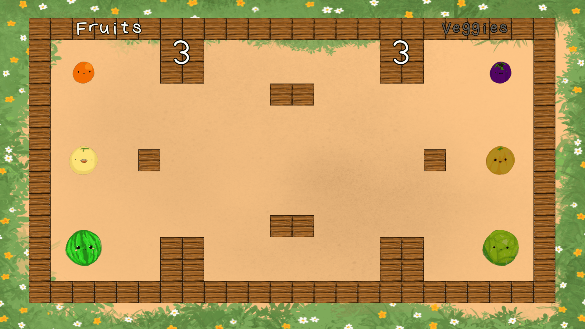

# Harvest Wars

**Two-player, turn-based physics game · Custom C++ engine · DigiPen team project (GAM200/250), 2025–2026**

![Harvest Wars gameplay]

  

▶ **[Download playable Windows build](https://github.com/xavierlikescats/Xaviers-Portfolio/releases/tag/Harvest-Wars-v1.0)**

Fruits vs. Veggies. Take turns launching your pieces into your opponent's pieces until all of theirs are destroyed.

**Role:** Programmer (team of N)
**Tech:** C++, custom engine, Tiled, JSON serialization, ImGui

---

## Systems I Built

| System | What I did |
|---|---|
| **Tilemap** | Replaced a tileset that could only be sized by width/height (tiles only on the border) with a Tiled-based map loaded through JSON serialization, so walls can be placed anywhere |
| **Tile collision** | Detection and response between the balls and tiles, including tile-to-world transforms, multi-point checks, and circle-based corner collisions |
| **Transform & Entity** | Wrote the engine's Transform component and much of the Entity code |
| **Scene transitions** | Fade in/out between the main menu and the game, layered correctly with the pause menu |
| **Turn & selection UI** | Bobbing arrow over the selected piece, hides its health bar, and makes it clear whose turn it is |
| **Game flow** | Match waits for every ball to stop moving before showing the win screen |
| **Audio** | UI hover/click sounds and a per-sound volume function used to rebalance the game's audio |
| **Credits** | Rebuilt the credits as a system inside the shared menu framework instead of a separate scene |

---

## Deep Dive: Tile Collision

Collision was my main responsibility on the project, and it took the most iteration.

### 1. Making tiles collide anywhere
The original collision only worked for tiles on the outer border. I rewrote it to convert each ball's check points into tile space, find the tile at each point, and respond if it's solid. A helper function generates the check points around the ball, so adding more points (left, right, up, down, and later the corners) took one line instead of a block of code per point.

### 2. The matrix bug
For weeks, collisions were *almost* right but kept breaking in some directions. Each fix worked for one wall and broke the others. I eventually went back to the tile-to-world matrix itself and checked the math by hand in Desmos. The translation used half the tileset's width and height, which assumes the tileset is centered at the origin. It wasn't, so every converted point was slightly off. It was close enough that neither I nor my teammate had caught it in review. After fixing the translation, the rest of the collision code worked as written.

### 3. Corners
Hitting a tile corner made the ball bounce as if it had hit whichever wall it was slightly closer to, which looked wrong.

- **First try:** pick a different normal depending on which corner was hit. That didn't hold up.
- **Second try:** a larger refactor of corner handling. Everything I tried broke something else, so I reverted it rather than commit unstable code.
- **What worked:** after talking it through with a teammate, I treated corners as **circle collisions**. A separate corner handler takes the normal from the contact point on the ball and the tile's center (converted to world space), so the ball bounces off the corner at the correct angle.

### 4. Corner sound effects
Corner hits sometimes registered several times in a row, playing the wall sound repeatedly. I added a check that skips the sound if the same object just hit the wall, and resets once the ball is no longer touching anything. This fixed most cases but not all.

**What I'd do differently:** track collision *enter/exit* state per pair of objects, so a sound or event fires once when contact starts. That fixes the root cause instead of filtering repeats afterward.

---

## Debugging Story: The Crash on Exit

Closing the game with the window's X caused a crash from a **double delete**. Setting the pointer to `nullptr` after deleting stopped the crash, but that would only have hidden the real problem, so I kept looking. With a teammate, I traced it to the tilemap's `Clone()` function: it made a **shallow copy**, so the original and the clone owned the same tile data and both freed it. I rewrote `Clone()` to do a proper deep copy, which fixed the crash at its source.

---

## Polish Details

- **Death "pop":** Destroyed pieces were supposed to shrink away. Because of how scaling was set up, shrinking past zero made them grow back upside down. The team found it funny, so we kept it and moved the particle burst to fire when the piece reaches full size, so it reads as a pop.
- **Readability:** Removed the outline from the selected piece and adjusted visuals so it's clear which pieces belong to whom.
- **Balancing:** Tuned piece weights and sizes, and fixed colliders that didn't match the new sprites (the art had extra whitespace).
- **Arenas:** Iterated on arena layouts with teammate feedback, and made each ball's starting position come from the arena data instead of being hard-coded.

---

## Team & Production

Besides programming, I turned the course rubric into a prioritized list of code tasks for the team, posted it on our Discord, and kept it updated through the final milestones so everyone knew what they owned.

**Team:** [Names and roles. Ask teammates before listing them.]
