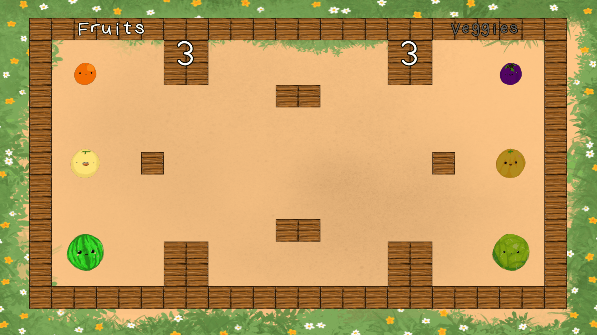

# Xavier Smith — Game Programmer

Computer Science and Game Design student at DigiPen Institute of Technology (expected 2028), looking for game programming and game design internships.
I work mainly in C++ and Unreal Engine 5, with experience in custom engines, gameplay systems, collision, procedural generation, and game AI.

📧 xavierlikescats@gmail.com · 📄 [Resume]([Assets/Resume.pdf](https://github.com/xavierlikescats/Xaviers-Portfolio/Blob/main/Assets/Resume.pdf))

---

## ⭐ Featured: Harvest Wars
**Custom C++ engine · Team project · 2025–2026**

  

A two-player, turn-based physics game built in a custom C++ engine.

**Role:** Programmer\
**Systems I built:** Tile collision, tilemap and its serialization, transforms and entities, scene transitions, turn indicators, UI audio, credits

▶ [Download Harvest Wars v1.0](https://github.com/xavierlikescats/Xaviers-Portfolio/releases/tag/Harvest-Wars-v1.0) · [Project details](HarvestWars/)

---

## 🛠️ In Progress

**Fossil Dwellers** — Unreal Engine 5, team project\
Runtime mining system using dynamic mesh subtraction for destructible terrain, with physics-based debris.

**Procedural Dungeon Generator** — Unreal Engine 5, solo project\
Branching room generation with dynamic doors and key-and-lock progression.
